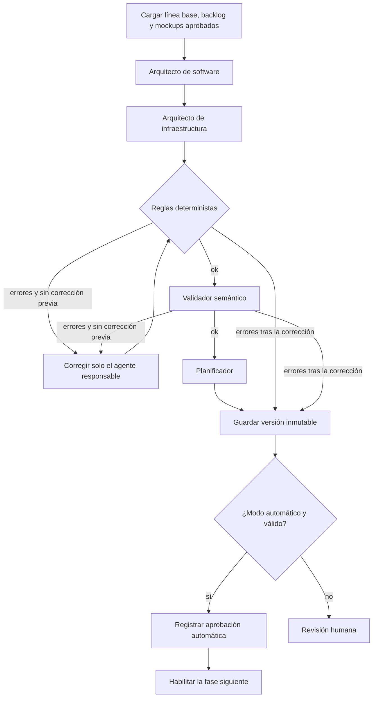

# Fase 4 · Arquitectura

Convierte el backlog publicado (y los mockups aprobados, si existen) en una arquitectura
técnica versionada, con diagramas y archivos para ejecutar el sistema en local y en la nube.

## Responsabilidades

| Pieza | ¿Usa modelo? | Responsabilidad |
|---|---|---|
| Arquitecto de software | Sí | Cómo está construida la aplicación: atributos de calidad (ISO 25010), decisiones ADR con tradeoffs, estilo monolítico, C4 (contenedores y componentes), relaciones y secuencias. |
| Arquitecto de infraestructura | Sí | Dónde y cómo funciona: entorno **local** (Docker Compose) y **nube** (AWS EKS, ALB, RDS, ECR, Secrets Manager, CloudWatch). |
| Reglas deterministas | No | IDs, cobertura de historias, catálogo de tecnologías, monolito con una sola API, despliegue en ambos entornos, dependencias del plan. |
| Validador | Sí | Coherencia semántica (atributos ↔ requisitos, reglas de negocio en backend, soporte de la infraestructura). |
| Modelo canónico | No | JSON `version_esquema 4.0` inmutable en `architecture_revisions`; decisión manual o automática en `architecture_decisions`. |
| Generador de diagramas | No | `app/services/diagrams.py`: vistas C4, despliegue, secuencia y flujo; `.drawio`, Mermaid, `docker-compose.yml`, `.env.example`, `k8s.yaml`, `README.md`. |
| Planificador | Sí | Tareas técnicas `TT-*` ordenadas, por rol, con dependencias y criterios de terminado (no son historias de usuario). |
| LangGraph | — | `app/agents/architecture_team.py`: orquesta, reanuda desde checkpoints y emite eventos. |

## Flujo

Si se corrige el software, la infraestructura se recalcula porque depende de sus contenedores.
Si quedan errores después de la única corrección, se guarda la versión para revisión humana
sin planificar (no se gastan tokens en un plan sobre un diseño inválido).

En modo automático, la arquitectura se aprueba solo con validación sin bloqueos y un plan técnico
completo. En modo manual, requiere decisión humana. Iniciar la fase siguiente sigue siendo explícito.

## Ahorro de tokens

- Contexto compacto: IDs y descripciones recortadas; sin historiales ni JSON completos.
- El arquitecto de infraestructura recibe solo contenedores, relaciones y atributos.
- Las reglas sin modelo corren antes del validador; el validador solo revisa semántica.
- Una corrección como máximo y dirigida al agente responsable.
- Diagramas y archivos generados con código: cero tokens. Las vistas se calculan al leer.
- Consumo real (tokens de entrada/salida, tiempo y llamadas por agente) guardado en
  `consumo` y visible en la pestaña *Validación y consumo*.

Ejecución de referencia (proyecto «Creación de Usuario en el Portal», sin correcciones):
4 llamadas, ~23 000 tokens y ~63 s.

## Catálogo de tecnologías

Se configura con `ARCHITECTURE_TECHNOLOGIES` en `.env` (lista JSON). Por defecto:
Angular, Nginx, Python, FastAPI, PostgreSQL, Docker, Docker Compose, Kubernetes, AWS EKS,
AWS ECR, AWS RDS PostgreSQL, AWS ALB, AWS Secrets Manager, AWS CloudWatch y SMTP.
Los sistemas existentes de la organización (por ejemplo Active Directory) se modelan como
`servicio_externo` y no se validan contra el catálogo.

## API

| Método | Ruta | Uso |
|---|---|---|
| GET | `/api/projects/{id}/architecture` | Versiones y decisiones |
| GET | `/api/projects/{id}/architecture/technologies` | Catálogo vigente |
| POST | `/api/projects/{id}/architecture/generate` | `{version_backlog, id_solicitud, instrucciones}` → 202 |
| GET | `/api/projects/{id}/architecture/{v}` | Modelo canónico + vistas |
| GET | `/api/projects/{id}/architecture/{v}/files/{nombre}` | `README.md`, `docker-compose.yml`, `.env.example`, `k8s.yaml`, `arquitectura.drawio`, `arquitectura.json` |
| POST | `/api/projects/{id}/architecture/{v}/review` | `{accion, nota}` |

Las ejecuciones detenidas se reanudan con `/executions/{run}/resume` como en las fases anteriores.

## Para el desarrollador

1. **Resumen:** qué se construye y dónde se ejecuta.
2. **Atributos de calidad:** metas medibles que el diseño debe cumplir.
3. **Decisiones y tradeoffs:** por qué se eligió cada opción y qué se sacrifica.
4. **C4:** ubica tu módulo, sus endpoints y dependencias.
5. **Infraestructura:** nodos locales y en EKS, variables de entorno (solo nombres, nunca valores).
6. **Secuencias y flujos:** camino principal y alternativo (por ejemplo, rechazo con motivo).
7. **Plan técnico:** tareas en orden, con rol y criterios de terminado.
8. **Archivos:** `docker compose up --build` para local; `kubectl apply -f k8s.yaml` para EKS.
   `arquitectura.drawio` se abre en diagrams.net.

## Pruebas

`tests/test_architecture.py` (sin red): reglas por agente responsable, RNF sin atributo,
monolito con una sola API, archivos de local y EKS, `.drawio` válido, contexto compacto,
nombres cortos de actores, flechas paralelas fusionadas y el grafo completo con agentes
simulados, incluida la corrección dirigida.
