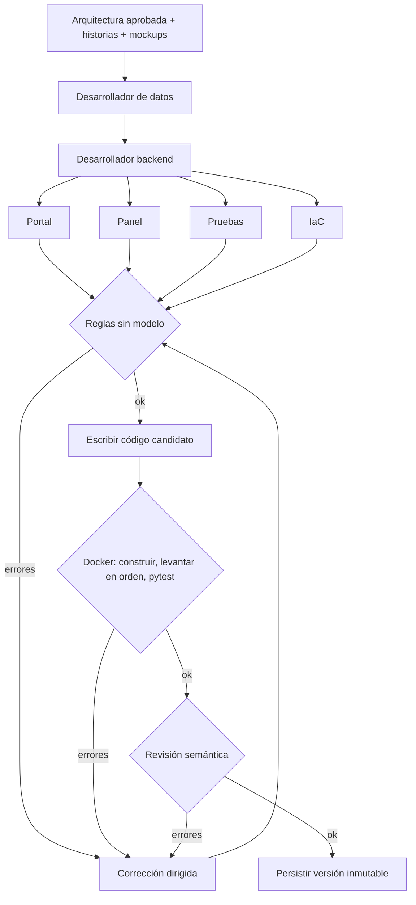

# Fase 5 · Construcción de la aplicación

Red de agentes que, a partir de la arquitectura aprobada, las historias y los mockups, construye la
aplicación completa, la **verifica ejecutándola en Docker** y se corrige sola hasta que funciona o
agota sus dos correcciones. El resultado se despliega en una instancia local que simula EC2
(ver `infraestructura-local/README.md`).

## Agentes

| Agente | Escribe en | Recibe (solo lo que necesita) |
|---|---|---|
| Desarrollador de datos | `db/` | Entidades, campos de las pantallas, reglas de negocio |
| Desarrollador backend | `backend/app/` | Componentes, historias y criterios, tablas, reglas |
| Desarrollador portal (empleado) | `portal/src/app/` | Solo pantallas y endpoints **públicos** de la aplicación del empleado |
| Desarrollador panel (aprobadores) | `panel/src/app/` | Pantallas de aprobación y **todos** los endpoints, incluidos los administrativos |
| Agente de pruebas | `backend/tests/` | Criterios de aceptación, endpoints, tablas, `main.py` |
| Agente IaC | `infra/terraform/` | Nodos de nube de la arquitectura |
| Validador | — | Reglas sin modelo, verificación en Docker y revisión semántica |

Cada agente solo puede escribir en su carpeta. Los archivos de infraestructura de la aplicación
(Dockerfiles, `package.json`, `angular.json`, nginx, `docker-compose.yml`) los genera una plantilla fija,
así que todo producto arranca igual.

## Separación de aplicaciones y seguridad

- Cada historia y cada pantalla se asigna a **portal** o **panel** según el actor que la usa
  (si el actor es líder, administrador, aprobador, etc.) o, si no hay historia, según su texto.
- La aplicación del empleado **no recibe** los endpoints `/api/admin/` en su contexto y las reglas
  comprueban que no los llame, que no maneje tokens y que ninguna pantalla de aprobación aparezca en ella.
- Las rutas `/api/admin/` exigen `Authorization: Bearer <ADMIN_API_TOKEN>` (`Depends(require_admin)`).
  Una ruta administrativa sin esa dependencia es un error bloqueante.
- No puede existir un listado público de datos que también existe en el administrativo.
- Hay una prueba obligatoria que comprueba el rechazo sin token (401 o 403).

## Flujo



- **Reglas sin modelo:** sintaxis Python y TypeScript, dependencias permitidas, secretos, rutas FastAPI
  reales leídas con `ast`, endpoints que llama cada interfaz frente a los que existen, cobertura de
  campos de cada mockup, criterios sin prueba, `docker-compose.yml` y Terraform.
- **Verificación en Docker:** levanta base de datos, backend, aplicaciones y balanceador en orden
  (`--wait` respeta las comprobaciones de salud) y ejecuta pytest dentro del contenedor. No publica
  puertos, así puede correr mientras hay una instancia activa, y siempre limpia sus contenedores.
  Cada error se atribuye al agente responsable según la salida de Docker o de pytest.
- **Correcciones:** como máximo **dos**. Un cambio en el backend vuelve a revisar a los agentes que lo
  consumen (portal, panel y pruebas).
- **Sin Docker:** la verificación se informa como advertencia, no como error de código.

En modo automático, una construcción se aprueba automáticamente únicamente si pasó reglas,
revisión semántica y ejecución real en Docker. Si Docker no está disponible, puede revisarse y
aprobarse manualmente, pero no se aprueba sola. El modo manual siempre pide decisión humana.
Desplegar una versión es una acción explícita en ambos modos; construir una versión no la publica
ni la pone en marcha.

## Carpeta del proyecto

```
workspace/<proyecto>/
  aplicacion/vN/       código ejecutable (db, backend, portal, panel, edge, infra, README)
  entregables/vN/      arquitectura (README, drawio, k8s), reporte-construccion.md,
                       resultado-instancia-local.md
```

Los `.env` (contraseñas y tokens) se crean al desplegar y están excluidos de git.

## API

| Método | Ruta | Uso |
|---|---|---|
| GET | `/api/projects/{id}/construction` | Versiones |
| POST | `/api/projects/{id}/construction/generate` | `{version_arquitectura, id_solicitud, instrucciones}` |
| GET | `/api/projects/{id}/construction/{v}` | Producto, carpetas, validación, instancia |
| GET | `/api/projects/{id}/construction/{v}/file?path=` | Contenido de un archivo generado |
| POST | `/api/projects/{id}/construction/{v}/deploy` | Desplegar en la instancia local |
| POST | `/api/projects/{id}/construction/{v}/stop` | Detener la instancia |
| POST | `/api/projects/{id}/construction/{v}/review` | Aprobar o rechazar |
| GET/POST | `/api/notifications` | Avisos de construcción y despliegue |

## Pruebas

`backend/tests/test_construction.py` (sin llamadas al modelo ni a Docker): reglas de separación y
seguridad con casos negativos para cada una, asignación de aplicaciones, composición de la instancia
local, escritura del producto y el grafo completo con agentes simulados, incluidos la corrección
dirigida, el fallo de ejecución devuelto al backend y la ausencia de Docker.

## Límites conocidos

- El stack es fijo: FastAPI + PostgreSQL + Angular (portal y panel) + Nginx + Docker, con Terraform
  para AWS. Un proyecto que necesite otra tecnología requiere nuevas plantillas.
- La instancia local simula EC2 con contenedores; no es una máquina virtual ni aplica Terraform.
- La autenticación del panel es un token administrativo compartido, suficiente para la demostración
  pero no sustituye a un proveedor de identidad.
