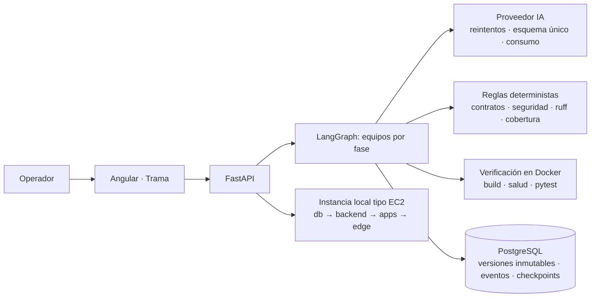

# Informe de auditoría técnica · Trama, fábrica de software multiagente

Fecha: 26/10/2026. Alcance: backend (FastAPI + LangGraph), frontend (Angular), red de agentes de las
fases 1 a 5, persistencia, despliegue local y software generado.

Criterio de este informe: solo se declara validado lo que se ejecutó. Cada afirmación indica su evidencia.

---

## 1. Diagnóstico inicial

**Cómo estaba construida.** Una aplicación local (FastAPI en `127.0.0.1:8000`, Angular en `:4200`,
PostgreSQL + pgvector en Docker) con cinco fases encadenadas, cada una con su equipo de agentes en
LangGraph, contratos Pydantic, versiones inmutables y aprobación humana:

| Fase | Agentes | Salida |
|---|---|---|
| 1 Análisis | Analista funcional + RAG híbrido (vectorial + BM25 + RRF) | Requisitos y líneas base |
| 2 Backlog | Organizador, redactor de historias, validador | Épicas, features, historias con criterios |
| 3 Diseño | Diseñador, validador | Mockups declarativos |
| 4 Arquitectura | Arquitecto de software, de infraestructura, validador, planificador | C4, ADR, infraestructura, plan |
| 5 Construcción | Datos, backend, portal, panel, pruebas, IaC, validador + reglas + verificación en Docker | Aplicación ejecutable e instancia local |

Tamaño: ~10.800 líneas de Python en el backend y ~1.000 en las vistas de Angular.

**Fortalezas existentes.** Contratos estrictos entre agentes, persistencia versionada e inmutable,
checkpoints de LangGraph (las ejecuciones se reanudan), eventos con consumo de tokens por agente, y
validación determinista antes del validador con modelo en las fases 4 y 5.

**Debilidades principales encontradas.**

1. **Pruebas que nunca se ejecutaban:** 39 de 116 pruebas (persistencia, API, borrado de proyectos,
   conocimiento compartido) se omitían siempre porque no existía la base de pruebas aislada.
2. **Fragilidad ante la API de IA:** sin reintentos; un solo `429` o `503` abortaba ejecuciones de 20 minutos.
3. **Errores sin diagnóstico:** no había `logging` en todo el backend y los fallos de fondo se guardaban
   solo con el tipo de excepción.
4. **Tokens desperdiciados:** cada llamada enviaba el esquema JSON dos veces.
5. **Incoherencia entre agentes:** un actor mal asignado en el backlog se propagaba hasta la aplicación
   generada (pantallas de aprobación en la app del empleado).
6. **Sin análisis estático ni de seguridad** del código generado.
7. **Sin control de versiones:** el proyecto no es un repositorio git.

---

## 2. Problemas identificados por criticidad

| # | Criticidad | Problema | Estado |
|---|---|---|---|
| 1 | Crítica | Proyecto sin control de versiones (git) | **Pendiente** (decisión del equipo) |
| 2 | Crítica | 39 pruebas de integración nunca ejecutadas | **Corregido**: se ejecutan y pasan |
| 3 | Crítica | Sin reintentos ante errores transitorios del proveedor de IA | **Corregido** |
| 4 | Alta | Fallos de fondo sin traza ni detalle | **Corregido** |
| 5 | Alta | Esquema JSON duplicado en cada llamada (tokens) | **Corregido**, medido |
| 6 | Alta | Actor de historia incoherente con su título, propagado hasta la construcción | **Corregido** |
| 7 | Alta | Código generado sin análisis estático ni de seguridad | **Corregido** |
| 8 | Alta | Separación empleado/administración no garantizada en el código generado | **Corregido** (fase 5) |
| 9 | Media | Validadores con modelo reportan confirmaciones como "advertencias" | **Corregido** (backlog y construcción) |
| 10 | Media | `iniciar.ps1` fallaba si PostgreSQL ya estaba corriendo | **Corregido** |
| 11 | Media | Dependencias de ejecución no declaradas (`pyyaml`, `ruff`) | **Corregido** |
| 12 | Media | API sin autenticación cuando `API_TOKEN` está vacío | **Mitigado** (solo loopback + aviso) |
| 13 | Media | Lógica de llamada a agentes y consumo duplicada en cuatro equipos | Pendiente |
| 14 | Media | Ciclo de construcción de 15–20 min (compilación en Docker) | Pendiente |
| 15 | Media | Sin auditoría de vulnerabilidades de dependencias (`pip-audit`, `npm audit`) | Pendiente |
| 16 | Baja | El panel generado usa un token compartido, no un proveedor de identidad | Pendiente |

---

## 3. Mejoras implementadas

### 3.1 Proveedor de IA (`app/providers.py`) — afecta a todos los agentes
- **Reintentos con espera exponencial** para `408, 429, 500, 502, 503, 504` y errores de red, respetando
  `Retry-After` (máximo 4 intentos, 30 s). Los errores del cliente (`400`, `401`...) no se reintentan.
- **El esquema se envía una sola vez:** en modo `responses` la API impone el esquema estricto; repetirlo
  como texto solo consumía tokens. En `chat_completions` se mantiene (allí no hay esquema estricto).
- `ProviderError` conserva el código HTTP.

### 3.2 Trazabilidad de fallos (`app/services/failures.py`, `app/main.py`, `app/api/*`)
- Todas las ejecuciones de fondo (análisis, ingesta, RAG, backlog, mockups, arquitectura, construcción)
  registran la traza completa en el log del servidor y guardan en el evento el tipo, el mensaje y el
  estado HTTP, con **enmascarado de secretos** (`api_key`, `token`, `password`, `Authorization: Bearer`).
- Aviso en el arranque si la API no exige clave.

### 3.3 Coherencia entre agentes (`app/services/roles.py`)
- Criterio único de "rol privilegiado" compartido por backlog y construcción (antes cada fase tenía el suyo).
- **Nueva regla `ACTOR_INCOHERENTE`** en el backlog: si el sujeto del título es un líder o aprobador y el
  actor asignado no lo es, la historia queda bloqueada. Solo mira el sujeto (primeras palabras) para no
  confundir "Empleado envía… para que su líder apruebe".
- Instrucción explícita al agente de historias para asignar el actor según el título.
- Filtro determinista de **confirmaciones disfrazadas de advertencias** en las revisiones con modelo.

### 3.4 Calidad y seguridad del software generado (`app/services/construction_rules.py`)
- **Análisis estático y de seguridad** del backend generado con `ruff`: errores de ejecución (`E9`, `F63`,
  `F7`, `F82` nombres no definidos) y reglas tipo Bandit (`S102` exec, `S307` eval, `S608` SQL armado con
  texto, `S105/S106` contraseñas en el código; estas dos se permiten en las pruebas).
- Cada hallazgo se asigna al agente responsable y entra en el ciclo de corrección.

### 3.5 Estabilización de la fase 5 (realizada durante esta misma jornada)
- Separación por aplicación: el portal del empleado no recibe ni puede llamar a `/api/admin/`; las rutas
  administrativas exigen `Depends(require_admin)`; un listado público que duplica uno administrativo es bloqueante.
- Shell de Angular fijo en la plantilla (los agentes solo escriben rutas y componentes).
- Detección de caracteres nulos, sintaxis de Pydantic v1 y URLs con plantillas.
- Atribución de fallos de Docker al contenedor que realmente falló.
- Comprobaciones de salud por `127.0.0.1` (en Alpine `localhost` resolvía a IPv6 y fallaba).
- Un timeout de Docker es un resultado de verificación, no una caída del proceso.

### 3.6 Operación
- `iniciar.ps1` ya no se detiene cuando el contenedor de PostgreSQL está en marcha.
- `requirements.txt` declara `pyyaml` y `ruff`.

---

## 4. Arquitectura resultante



Principio de cada etapa: **el modelo propone, las reglas y la ejecución verifican**. Una etapa no avanza
porque otro agente diga que terminó: avanza cuando pasan las reglas, la compilación, las comprobaciones de
salud y las pruebas. Si algo falla, vuelve solo al agente responsable con el error exacto (máximo dos
correcciones) y el resultado queda versionado para revisión humana.

---

## 5. Calidad y pruebas ejecutadas

| Validación | Resultado | Evidencia |
|---|---|---|
| Suite backend completa con base aislada `fabrica_test` | **126 aprobadas, 0 omitidas** | `pytest` con `TEST_DATABASE_URL` |
| Pruebas nuevas de esta auditoría | 10 (proveedor, fallos, roles, análisis estático) | `tests/test_providers.py`, `test_failures.py`, `test_roles.py`, `test_construction.py` |
| Lint del backend | Sin errores | `ruff check` |
| Frontend | Compila; 3/3 pruebas | `ng build`, `npm test` |
| Llamada real a Azure tras el cambio del proveedor | Contrato válido | prueba mínima con `ArtifactReview` |
| Análisis estático sobre el producto v10 desplegado | 0 hallazgos | `static_findings` sobre sus 26 archivos |
| Instancia local v10 | Portal y panel `200`, pytest 7/7 | despliegue por etapas |
| Arranque con `iniciar.ps1` | Backend y frontend `200` | ejecución real |

Para repetir las pruebas de integración:

```powershell
$env:TEST_DATABASE_URL = "postgresql://fabrica:<clave>@127.0.0.1:5543/fabrica_test"
.\.venv\Scripts\python.exe -m pytest -q backend/tests --ignore=backend/tests/test_live.py --ignore=backend/tests/test_backlog_live.py
```

**No validado:** después de estos últimos cambios no se ejecutó una construcción completa de punta a punta
(tarda 15–20 min). Los cambios que la afectan tienen pruebas unitarias, de integración y una llamada real.

---

## 6. Comparación antes y después

| Aspecto | Antes | Después | Evidencia |
|---|---|---|---|
| Pruebas ejecutadas | 77 (39 omitidas siempre) | 126, ninguna omitida | pytest |
| Tokens de entrada por llamada (contrato de revisión) | 542 | 230 (**−58 %**) | medición A/B con la API real |
| Esquema más grande (arquitectura) | ~1.650 tokens extra por llamada y por reintento | 0 | tamaño del esquema |
| Fallo transitorio del proveedor | Aborta la ejecución | Hasta 4 intentos con espera | prueba `429→503→200` |
| Diagnóstico de un fallo de fondo | Solo el tipo de excepción | Traza + mensaje + estado HTTP, sin secretos | prueba de enmascarado |
| Actor incoherente en el backlog | Se propagaba a la app generada | Bloqueado en la fase 2 | prueba `ACTOR_INCOHERENTE` |
| Seguridad del código generado | Sin análisis | eval/exec, inyección SQL, contraseñas, nombres no definidos | prueba con código inseguro |
| Separación empleado/administración | No garantizada | Reglas bloqueantes + contexto separado | 25 pruebas de construcción |

---

## 7. Riesgos pendientes y mejoras priorizadas

1. **Control de versiones (crítico).** Inicializar git con el `.gitignore` existente (ya excluye `.env`,
   secretos de instancias y artefactos). Sin esto no hay historial ni forma segura de revertir cambios.
2. **Integración continua.** Ejecutar en cada cambio `ruff`, la suite con `fabrica_test` y `ng build`.
3. **Duración de la construcción.** Imágenes base precompiladas con las dependencias de Angular y Python
   para reducir cada ciclo de minutos a segundos.
4. **Refactor de los equipos de agentes.** Extraer la llamada común (eventos, consumo, errores) que hoy
   está duplicada en cuatro equipos.
5. **Auditoría de dependencias** (`pip-audit`, `npm audit`) del software generado; requiere red.
6. **Autenticación.** `API_TOKEN` obligatorio si la plataforma deja de ser local; proveedor de identidad
   (OIDC) para el panel de las aplicaciones generadas en lugar de un token compartido.
7. **Datos del backlog existentes.** Las historias de líder del proyecto actual siguen con el actor
   "Empleado"; la nueva regla lo bloqueará en la próxima generación del backlog.
8. **Pila fija.** El software generado es FastAPI + PostgreSQL + Angular + Nginx. Otra tecnología exige
   nuevas plantillas y reglas.
